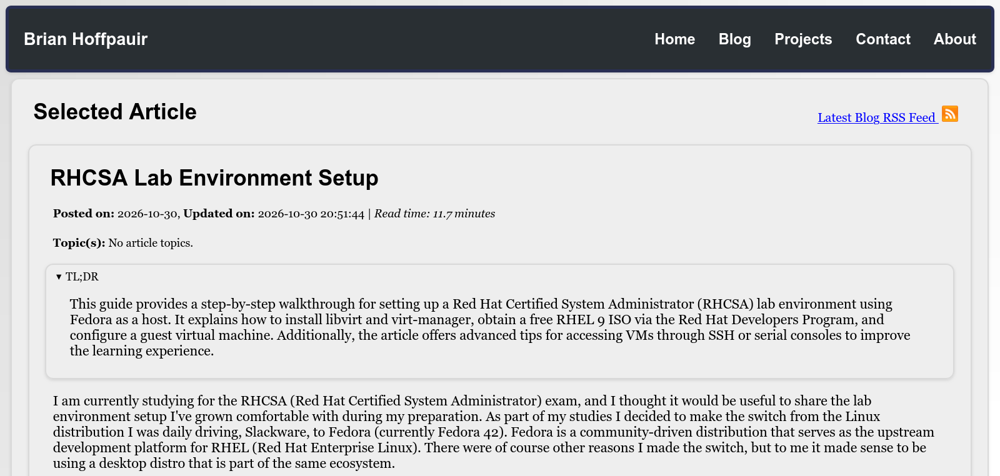

# Overview

My project is a feature addition for my personal blog website (made with PHP's Laravel framework). My goal is to use an FOSS, inexpensive hosted LLM and the LLPhant library to generate and cache TLDR descriptions for my blog posts. Site visitors can use the brief overviews to quickly determine if they wish to read one of my blog posts. The overviews are visible using a collapsible pane that appears above each blog post when the user visits the post's reading page.

# Design

The overviews are generated in response to the following conditions: blog post creation, blog post updates, and blog post deletions. The summaries are implemented as a separate table in the site's database that refer to the unique ID for their associated post.

# Future Work

- Better front-end styling for the AI overview pane.
  - Including note showing which model was used.
- Optional disable checkbox to disable the overview that is persistent across pages.
- Additional documentation for the additional models, database migrations, and methods that were added to support the new AI overview feature.

